# Subir un proyecto Angular a Vercel

Guía paso a paso con capturas reales, desde iniciar sesión hasta tener el sitio publicado. El ejemplo es un tablero Kanban hecho con Angular 21, alojado en GitHub y desplegado en el plan gratuito.

- **Repositorio de ejemplo:** `cbarralesp/kanban-frontend`
- **Plan:** Hobby (gratis)
- **Tiempo de despliegue:** 26 segundos

## Índice

1. [Antes de empezar](#antes-de-empezar)
2. [Iniciar sesión](#1-iniciar-sesión-en-vercel)
3. [Crear un proyecto nuevo](#2-crear-un-proyecto-nuevo)
4. [Dar acceso al repositorio](#3-dar-acceso-al-repositorio)
5. [Configurar el proyecto](#4-configurar-el-proyecto)
6. [Pulsar Deploy](#5-pulsar-deploy)
7. [Comprobar el resultado](#6-comprobar-el-resultado)
8. [Problemas comunes](#problemas-comunes)
9. [Después del deploy](#después-del-deploy)
10. [Límites del plan gratis](#límites-del-plan-gratis)
11. [Publicar en GitHub Pages](#publicar-en-github-pages)

---

## Antes de empezar

Vercel no recibe el proyecto por correo ni por carpeta: lo lee desde un repositorio Git y lo compila en sus servidores. Necesitas tres cosas:

- [ ] **Un repositorio en GitHub** con tu proyecto Angular ya subido (rama `main`). Debe estar en tu usuario personal si usas el plan gratis.
- [ ] **Una cuenta en Vercel.** Puedes entrar con Google, GitHub o correo. Con GitHub el repositorio queda enlazado más rápido.
- [ ] **Un proyecto que compile.** Pruébalo en tu equipo antes de subir:

```bash
npm install
npm run build
```

Si ese comando falla en tu equipo, también fallará en Vercel. La carpeta con el resultado queda en `dist/<nombre-del-proyecto>/browser`.

---

## 1. Iniciar sesión en Vercel

Entra a <https://vercel.com/login> y elige tu método. Vercel marca con *Last Used* el que usaste la última vez.

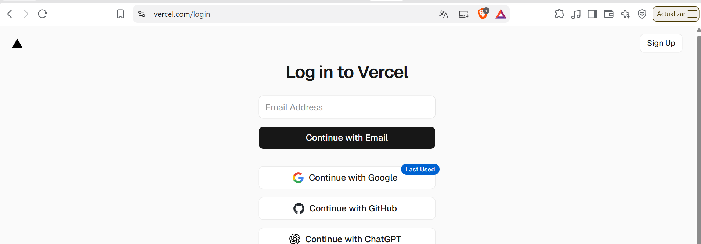

*Pantalla de inicio de sesión de Vercel.*

### Si tu cuenta tiene verificación en dos pasos

Vercel pide el código de 6 dígitos de tu app de autenticación. Escríbelo y pulsa **Verify**. Si perdiste el acceso, usa *Use a Recovery Code Instead*.

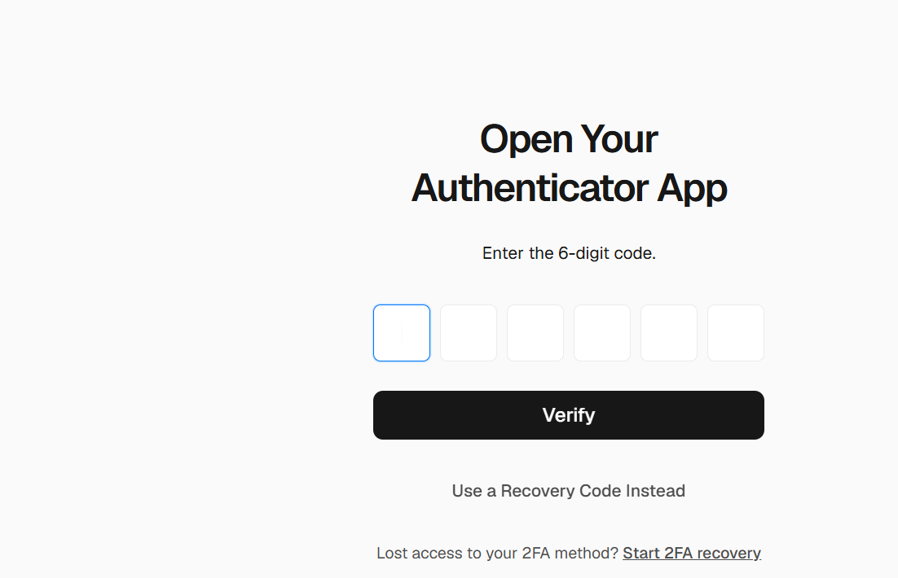

*Verificación en dos pasos (2FA).*

> **Seguridad:** no compartas capturas con la dirección completa de esta pantalla. La URL lleva un token temporal.

---

## 2. Crear un proyecto nuevo

En el panel principal pulsa **Create New** (arriba a la derecha) y luego **Project**. El menú también ofrece Domain, Store, Integration y otras opciones que no necesitas ahora.

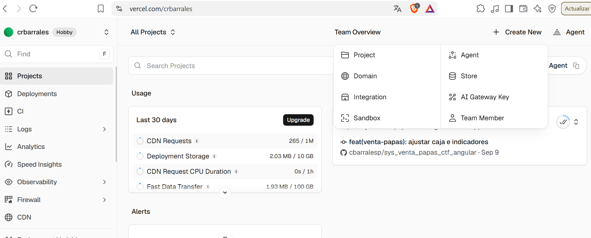

*Panel del equipo: Create New → Project.*

Se abre **Import Git Repository**, con la lista de repositorios de tu cuenta de GitHub. Cada uno tiene un botón **Import**.

---

## 3. Dar acceso al repositorio

Si tu repositorio no aparece en la lista, Vercel todavía no tiene permiso para verlo. Es lo más común con repos recién creados.

1. Debajo de la lista pulsa **Adjust GitHub App Permissions**.

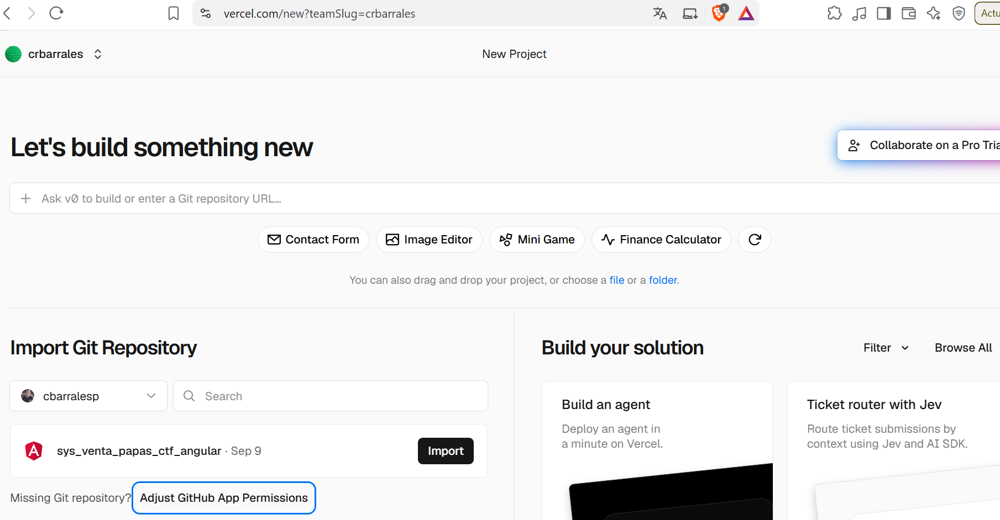

*El enlace queda justo bajo la lista de repositorios.*

2. GitHub abre la configuración de la app de Vercel (*Settings → Applications*).

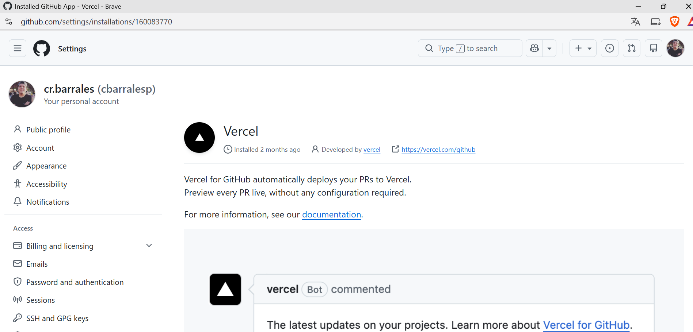

*Configuración de la app instalada en GitHub.*

3. Baja hasta **Repository access**. Deja marcado **Only select repositories**, abre *Select repositories* y agrega el repo nuevo.
4. Pulsa **Save**.

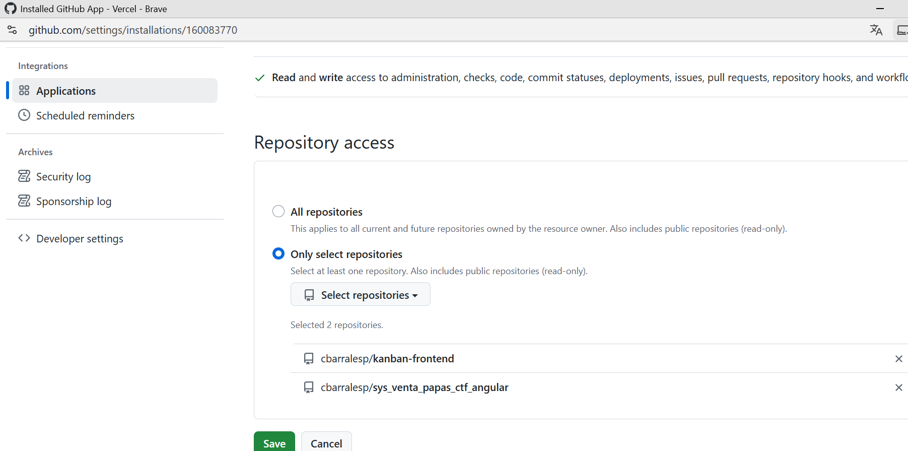

*Aquí quedan autorizados `kanban-frontend` y el otro repositorio de la cuenta.*

Vuelve a Vercel y recarga la página *New Project*. Ahora el repositorio aparece en la lista. Pulsa **Import**.

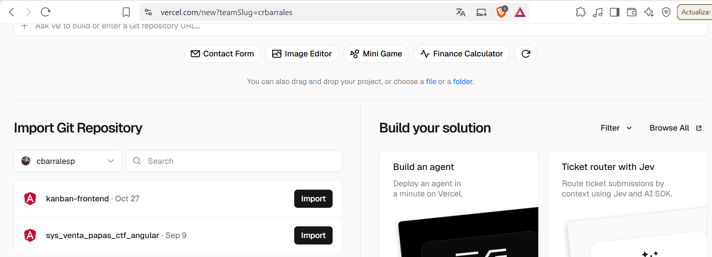

*Repositorio visible y listo para importar.*

> **Dato útil:** elegir *Only select repositories* es lo más seguro. Vercel solo ve los repos que tú autorizas.

---

## 4. Configurar el proyecto

En la pantalla **New Project** Vercel detecta Angular y rellena casi todo.

| Campo | Qué poner |
|---|---|
| Vercel Team | Tu equipo personal (aquí `crbarrales`, plan Hobby). |
| Project Name | El nombre que dará la URL `nombre.vercel.app`. Minúsculas y guiones. |
| Root Directory | `./`. Cámbialo solo si el Angular vive en una subcarpeta del repo. |
| Application Preset | `Angular`. Si dice «Other», selecciónalo a mano. |

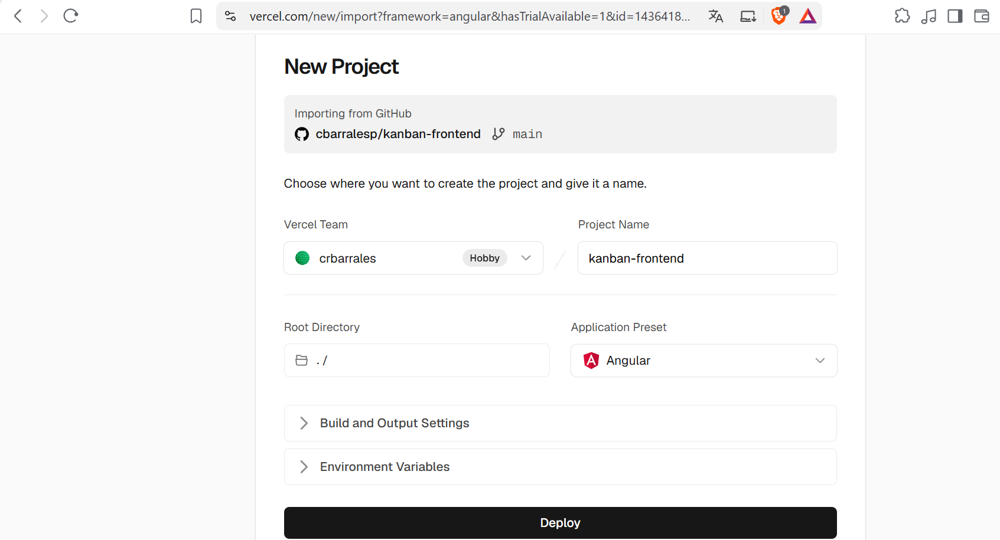

*Importando `cbarralesp/kanban-frontend`, rama `main`.*

### Build and Output Settings

Despliega la sección para revisarla. Los textos en gris son valores por defecto de Vercel. **Déjalos vacíos**: el preset de Angular lee tu `angular.json` y deduce la carpeta de salida.

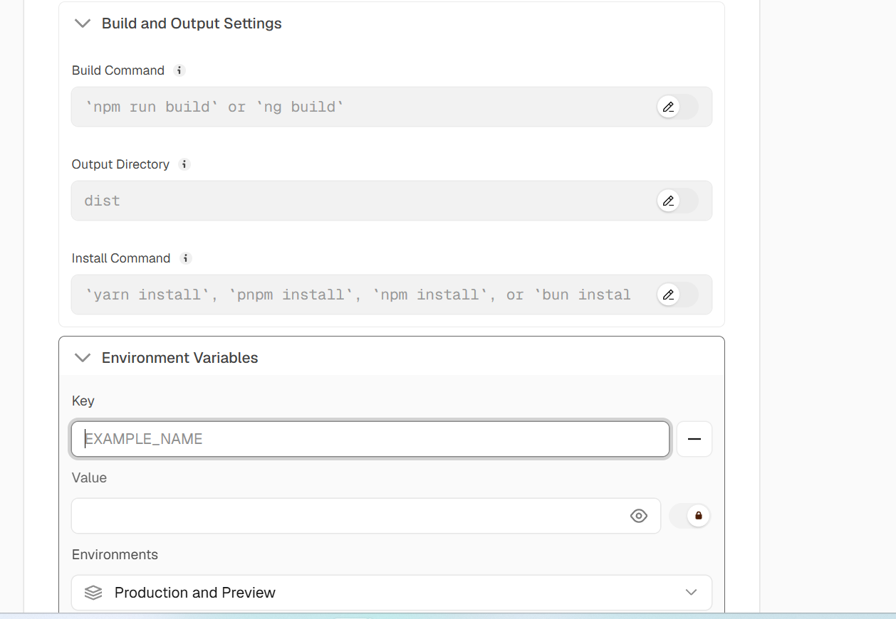

*Build Command, Output Directory, Install Command y variables de entorno.*

| Campo | Valor |
|---|---|
| Build Command | `ng build` o `npm run build` (por defecto) |
| Output Directory | Por defecto. Para este proyecto es `dist/kanban-frontend/browser`. |
| Install Command | `npm install` (por defecto) |
| Environment Variables | Vacío, salvo que uses variables propias. |

---

## 5. Pulsar Deploy

Con todo revisado, pulsa el botón negro **Deploy**. Si Vercel te pide confirmar tu identidad otra vez (reautenticación), introduce el código de tu app de autenticación y continúa.

Aparece la pantalla **Deployment** con el progreso:

- **Build Logs:** el registro de `npm install` y `ng build`. Un aviso amarillo como `npm warn Unknown env config "cache-dir"` es normal y no bloquea nada.
- **Deployment Summary** y **Deployment Checks:** se completan solos.
- **Assigning Custom Domains:** asigna la URL `.vercel.app`.

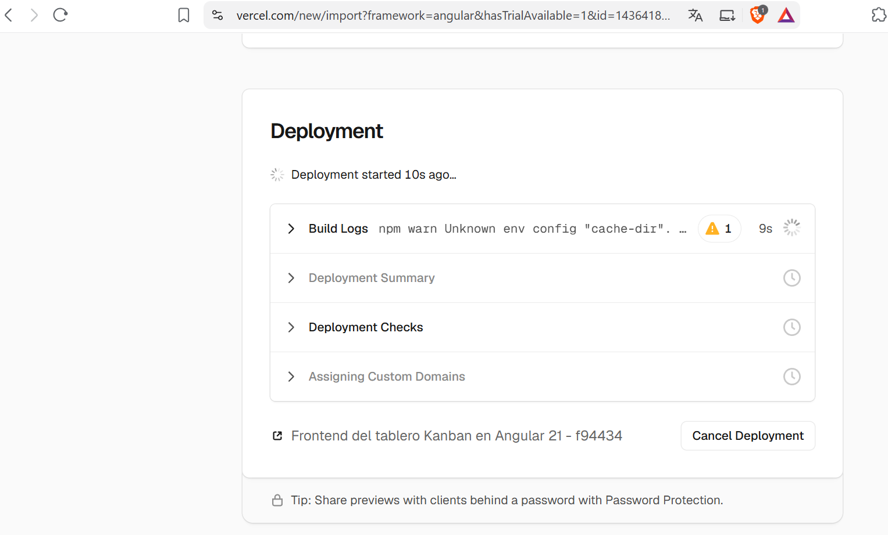

*Build en curso. No pulses Cancel Deployment.*

---

## 6. Comprobar el resultado

Al terminar aparece **Deployed to Production**, con una miniatura del sitio y el tiempo total. Aquí fueron 26 segundos.

- **Visit** abre el sitio en su URL pública.
- **Continue to Project** lleva al panel del proyecto (deployments, dominios, ajustes).
- El icono junto a Visit copia la URL.

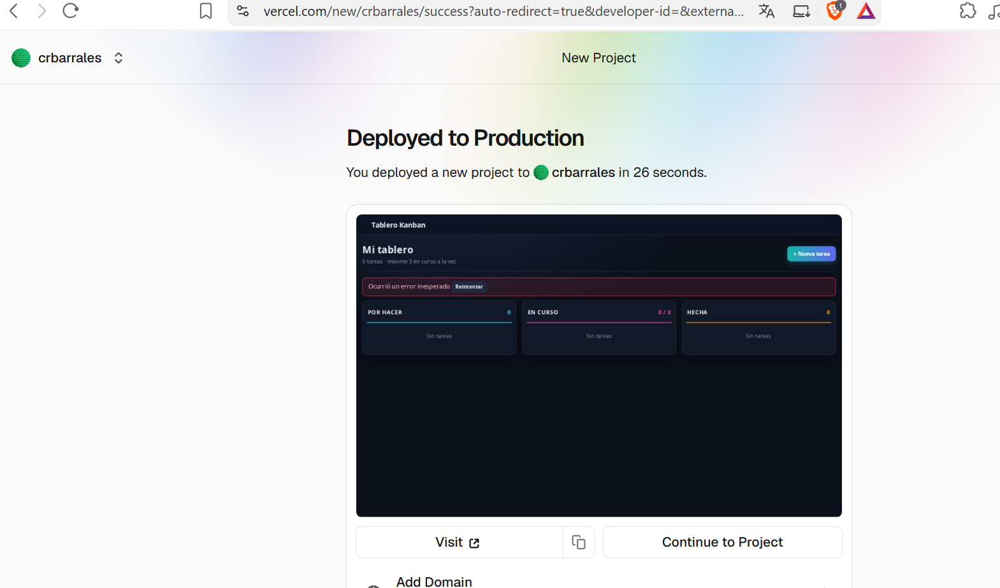

*Despliegue exitoso del tablero Kanban.*

> **Ojo con esta captura:** la miniatura muestra un banner rojo («Ocurrió un error inesperado») y las columnas vacías. El despliegue funcionó. Lo que falla es la conexión del front con su backend. Mira «El sitio abre, pero no carga datos» en la sección siguiente.

---

## Problemas comunes

### El sitio abre en blanco o responde 404

Casi siempre es la carpeta de salida. En Vercel entra al proyecto → *Settings* → *Build and Output Settings*, activa el lápiz de **Output Directory** y escribe la ruta real:

```text
dist/<nombre-del-proyecto>/browser
```

El nombre sale de la clave `projects` en tu `angular.json`. Guarda y vuelve a desplegar.

### Al recargar una ruta (por ejemplo /board) sale 404

Angular maneja las rutas en el navegador, pero el servidor no las conoce. Crea un archivo `vercel.json` en la raíz del repositorio:

```json
{ "rewrites": [{ "source": "/(.*)", "destination": "/index.html" }] }
```

Haz commit y push a `main`. Vercel redespliega solo.

### El sitio abre, pero no carga datos

Si tu front llama a un API en `http://localhost:8080`, esa dirección solo existe en tu equipo. Desde Vercel nadie puede llegar a ella. Tienes dos caminos:

- Desplegar el backend en un servicio público y cambiar la URL en `src/environments/environment.ts`.
- Si el API ya es público, solo cambiar esa URL, hacer commit y push.

El API público debe permitir peticiones desde tu dominio `.vercel.app` (CORS).

### El build falla

Abre **Build Logs** y lee las últimas líneas. Causas habituales:

- El proyecto no compila en tu equipo con `npm run build`. Corrígelo primero ahí.
- Un archivo escrito con otra mayúscula o minúscula en un import. Linux distingue entre `Board.ts` y `board.ts`; Windows no.
- Falta una dependencia en `package.json` que solo tenías instalada de forma global.

### Mi repositorio no aparece en la lista

Repite el [paso 3](#3-dar-acceso-al-repositorio): *Adjust GitHub App Permissions*, agrega el repo y guarda. Si el repo es de una organización de GitHub, el plan Hobby no lo permite.

---

## Después del deploy

- **Despliegue automático.** Cada `git push` a `main` genera un nuevo despliegue de producción. Eso es tu integración y entrega continua (CI/CD), sin configurar nada más.
- **Previews.** Cada rama y cada pull request recibe su propia URL de prueba.
- **Historial.** En *Deployments* puedes volver a una versión anterior si algo sale mal.
- **Dominio propio.** En *Settings → Domains* puedes agregar el tuyo. Si no, queda `nombre.vercel.app`.

---

## Límites del plan gratis

Según la [documentación oficial de Vercel](https://vercel.com/docs/limits) (revisada en noviembre de 2026):

| | Hobby | Pro |
|---|---|---|
| Proyectos | 200 | Ilimitados |
| Despliegues por día | 100 | 6000 |
| Proyectos por repo de Git | 25 | 150 |

El plan Hobby no permite conectar repositorios que pertenezcan a una organización de GitHub: el repo debe estar en tu cuenta personal.

---

## Publicar en GitHub Pages

GitHub Pages publica sitios estáticos (HTML, CSS, JavaScript e imágenes) directamente desde un repositorio, gratis y sin servidor. Sirve para documentación, portafolios y manuales como este. No ejecuta backends. Una aplicación Angular necesita compilarse antes, y para eso Vercel es más cómodo.

### Antes de empezar

- [ ] Un repositorio en GitHub. En el plan gratis debe ser **público**.
- [ ] Un archivo llamado `index.html` en la **raíz** del repositorio. Es la página de inicio del sitio.
- [ ] Los archivos ya subidos a la rama `main`.

### Paso 1. Subir los archivos

Desde la carpeta de tu proyecto:

```bash
git add .
git commit -m "Publicar sitio"
git push origin main
```

### Paso 2. Abrir Settings → Pages

En el repositorio pulsa **Settings** y, en el menú de la izquierda, entra a **Pages**.

### Paso 3. Elegir de dónde se publica

1. En **Source** elige *Deploy from a branch*.
2. En **Branch** selecciona `main` y la carpeta `/ (root)`.
3. Pulsa **Save**.

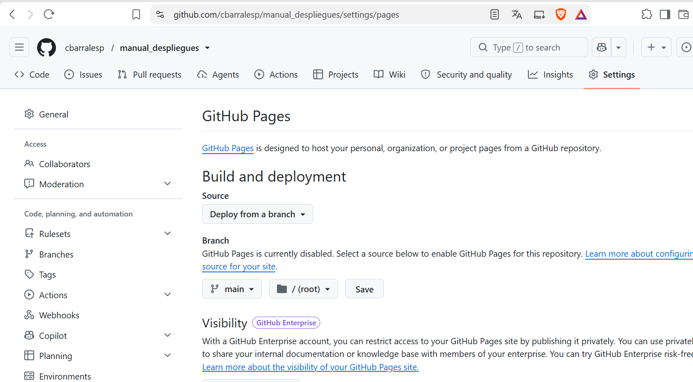

*Settings → Pages antes de guardar. El mensaje «GitHub Pages is currently disabled» indica que todavía no está activado.*

### Paso 4. Confirmar que se guardó

Aparece una franja azul con *GitHub Pages source saved*. Debajo, el texto cambia a *Your GitHub Pages site is currently being built from the main branch*. Eso significa que GitHub empezó a construir el sitio.

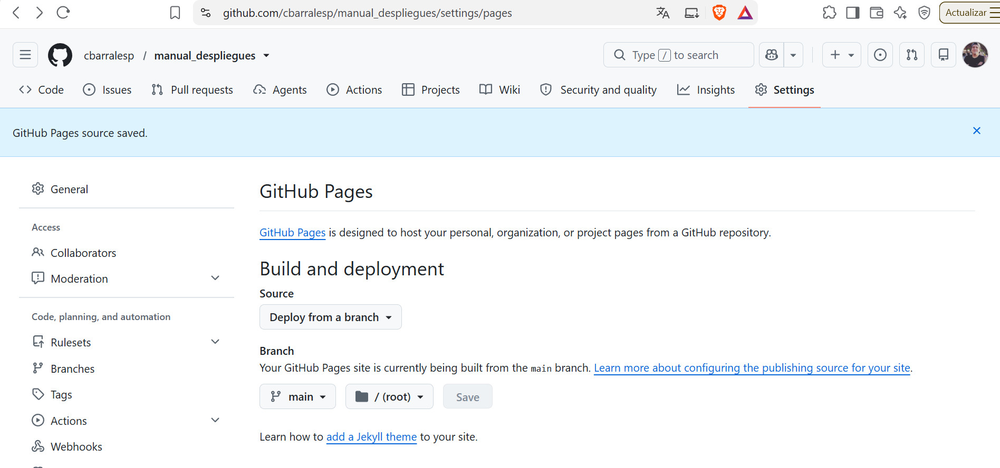

*Configuración guardada: el sitio se está construyendo desde la rama `main`.*

### Paso 5. Esperar y abrir el sitio

La publicación tarda de uno a dos minutos. Para seguirla tienes dos opciones:

- Recarga **Settings → Pages**. Cuando termina, arriba aparece la dirección de tu sitio con un botón para visitarlo.
- Abre la pestaña **Actions**. Ahí corre un proceso llamado *pages build and deployment*. Cuando queda en verde, el sitio está publicado.

Cuando termina, arriba aparece el aviso *Your site is live at* con la dirección del sitio. Pulsa **Visit site** para abrirlo. El botón rojo **Unpublish site** retira el sitio: no lo pulses si quieres que siga publicado.

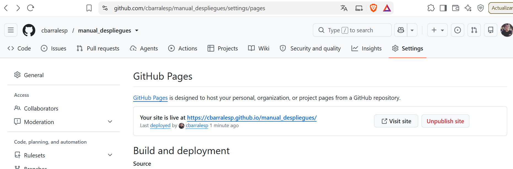

*Sitio publicado: la dirección aparece en Settings → Pages.*

Al abrir la dirección ves tu `index.html` funcionando en Internet.

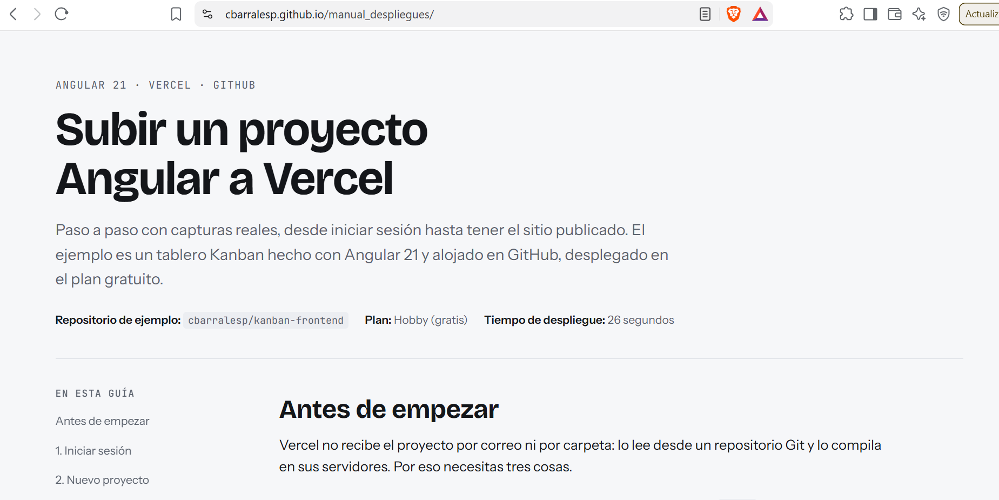

*El manual abierto desde su dirección pública.*

La dirección sigue siempre este formato:

```text
https://<usuario>.github.io/<repositorio>/
```

Por ejemplo, para el usuario `cbarralesp` y el repositorio `manual_despliegues`: `https://cbarralesp.github.io/manual_despliegues/`.

### Actualizar el sitio

No hay que repetir la configuración. Cada `git push` a `main` vuelve a publicar el sitio en uno o dos minutos.

### Problemas comunes

**Sale 404 al abrir la dirección.** Espera un par de minutos y recarga. Si sigue igual, confirma que `index.html` esté en la raíz del repo, no dentro de una carpeta, y que en Pages esté seleccionada la carpeta `/ (root)`.

**La página abre, pero sin estilos o sin imágenes.** Casi siempre son rutas mal escritas. Usa rutas relativas como `img/foto.png`, sin `/` al inicio. GitHub Pages distingue mayúsculas y minúsculas: `Foto.png` y `foto.png` son archivos distintos.

**No me aparece la opción de Pages o no me deja activarla.** Revisa que el repositorio sea público. En el plan gratis, Pages no funciona con repositorios privados.

**Hice push, pero el sitio no cambia.** Espera uno o dos minutos y recarga con `Ctrl + F5`. Si sigue igual, revisa la pestaña **Actions**: un proceso en rojo indica un error de publicación.

---

*Manual elaborado con capturas reales de un despliegue de Angular 21 en Vercel. Los nombres de pantallas y botones están en inglés porque así los muestra Vercel.*
